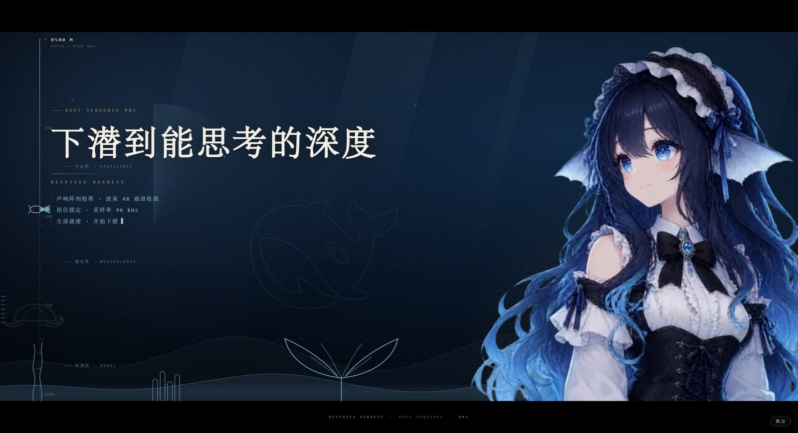

# dsh-startup

> 给 **DeepSeek Harness** 做的一次**深海下潜**式启动动画：深度尺与探测器、鲸鱼娘出场视频、海底地形与珊瑚礁、气泡与生物荧光。



> A deep-sea dive splash screen for DeepSeek Harness — depth gauge, submersible probe, a character reveal video, seafloor relief, coral reef and bioluminescent particles. **Pure HTML/CSS/JS, no build step, no framework.**

---

## 它长什么样

整段约 **9.4 秒**，然后自动消失：

```
0.0s  黑场淡出，海底背景亮起
1.0s  主标题「下潜到能思考的深度」以字距收紧 + 模糊对焦浮出
1.6s  第一行读数：声呐阵列校准 · 波束 48 通道收敛
2.4s  金色细线扫开
2.55s 她的出场视频切到无缝循环段 —— 之后一直在动
2.6s  第二行读数：相位锁定 · 采样率 96 kHz
3.6s  第三行读数：全部就绪 · 开始下潜
4.6s  深度走到 1000m，探测器停在尺底
9.4s  收尾
```

**深度是有意义的**：左侧深度尺的读数决定出现什么生物。

| 深度带 | 生物 |
|---|---|
| 0–250m 光合带 | 海龟（远处的影子） |
| 250–600m 微光带 | 鱼群 |
| 600–1000m 深渊带 | 海马 |

珊瑚礁、气泡、浮游、海雪、体积光则一直在。

---

## 安装

### 方式一：一键脚本（推荐，不用 npm）

```powershell
git clone https://github.com/holy-ovo/dsh-startup.git D:/dev/dsh-startup
cd D:/dev/dsh-startup
powershell -ExecutionPolicy Bypass -File .\install.ps1
```

脚本会：在 profile 的 `node_modules` 里建目录链接 → 往 `dependencies` 登记 →
加进 `dsh.profile.bundles`（改之前备份 `package.json.bak-install`）。

**装完必须完全退出 DSH Desktop 再打开**（只刷新页面不够，加载器要重启才读新的 bundles）。

卸载：`powershell -ExecutionPolicy Bypass -File .\uninstall.ps1`

### 方式二：插件市场（npm 发布后才可用）

> **目前尚未发布到 npm**，所以市场里还没有安装按钮 —— 现在请用**方式一**。

包发布到 npm 后，在市场里搜 `@klasjdfkl/dsh-startup` 一键安装。

> 桌面客户端的安装边界只接受 `name@x.y.z` 形式的 npm 包，
> 所以**只有发布到 npm 之后**市场里才有安装按钮；仅 GitHub 的插件在市场里是“浏览模式”。
> 这也意味着：**没有 npm 也照样能装**（方式一 / 方式三都绕开了市场），
> 商城只是“发现渠道”，不是唯一的安装通道。

### 方式三：手动登记（想看清楚每一步时）

```bash
# 1. 克隆到任意目录
git clone https://github.com/holy-ovo/dsh-startup.git D:/dev/dsh-startup

# 2. 在 profile 里登记（Windows 示例，路径换成你的）
#    编辑 %APPDATA%\dsh-desktop\harness\profiles\web\package.json
#    a) dependencies 增加：  "@klasjdfkl/dsh-startup": "link:D:/dev/dsh-startup"
#    b) dsh.profile.bundles 增加：  "@klasjdfkl/dsh-startup"

# 3. 建一个目录链接（Windows）
mkdir "%APPDATA%\dsh-desktop\harness\profiles\web\node_modules\@klasjdfkl"
mklink /J "%APPDATA%\dsh-desktop\harness\profiles\web\node_modules\@klasjdfkl\dsh-startup" "D:\dev\dsh-startup"

# 4. 重启 DSH 桌面端
```

安装成功后在 **插件 → 已安装** 里能看到 `@klasjdfkl/dsh-startup 0.1.0`。

### 卸载

从 `dependencies` 和 `dsh.profile.bundles` 里删掉 `@klasjdfkl/dsh-startup`，删掉
`node_modules\@holy-ovo\dsh-startup` 链接，重启。

---

## 它怎么工作（给改代码的人）

DSH 的插件是**宿主半边**：通过 `webServer` 注册路由，再往首页注入两行。

```js
// index.js
export default {
  name: 'dsh-startup',
  inject: ['webServer'],
  apply(ctx) {
    // 1) 视频路由（带 Range，<video> 才能 seek）
    ctx.webServer.register({ kind: 'exact', path: '/dsh-startup/intro', handler: createVideoHandler(ASSET) })
    ctx.webServer.register({ kind: 'exact', path: '/dsh-startup/idle',  handler: createVideoHandler(ASSET_IDLE) })

    // 2) 首页注入：一行 html（结构 + 样式）+ 一行 script（驱动）
    ctx.on('webserver/index-inject', (table) => {
      table.push({ kind: 'html',   placement: 'body', html: readText('splash.html') })
      table.push({ kind: 'script', placement: 'body', text: readText('client.js') })
    })
  },
}
```

三个刻意的设计：

1. **必须发生的事全部由纯 CSS 完成。** 开屏的消失是一条 CSS 动画
   （`@keyframes dsh-sp-hide`），脚本挂了、视频挂了，它照样在 9.4 秒后收掉。
   脚本只做增强。
2. **每次渲染首页时重读 `splash.html` / `client.js`。** 改样式只要刷新页面，
   不用重启宿主（只有 `index.js` 的改动才需要重启）。
3. **时间锚点 kill switch。** 一旦 `<html>` 被打上 `dsh-splash-done`，
   之后任何重复注入的副本都会直接不可见，不会再播一遍。

---

## 可调参数

| 项 | 位置 | 当前值 |
|---|---|---|
| 开屏时长 | `splash.html` 的 `animation: dsh-sp-hide 9.4s` | 9.4s |
| 切到循环段的时刻 | `client.js` 的 `SWITCH_AT` | 2.55s |
| 深度带阈值 | `client.js` 的 `setZone()`（0.25 / 0.6） | 250m / 600m |
| 深度推进节奏 | `client.js` 的 `DROPS` | 4 个落点，每行 250m |
| 气泡数量 | `splash.html` 的 `.sp-bubbles` | 28 颗 |
| 鲸鱼线稿 | `splash.html` 的 `.sp-mark` | 19vw / 6% |

---

## 已知限制

- **视频分辨率**：538×646，在 2K 屏上会被放大近 2 倍，边缘偏软。
  要更清晰需要重出 1080×1296 的素材，改 `assets/` 即可，代码不用动。
- **生物是手绘路径**：海龟、海马、鱼群是手写的 SVG 曲线，做了模糊 + 降透明度的
  "远处影子"处理。近看仍然能看出是手绘。
- **Windows 合成层**：视频和文字层都加了 `translateZ(0)`，否则 Electron 里
  硬件解码的视频可能跑到 overlay 平面、盖住文字。
- **每次刷新都会播**：目前没有"每次启动只播一次"的节流。

## 开发

```
index.js          宿主半边：两条路由 + 注入行
splash.html       结构与全部样式（单文件，无构建）
client.js         切段 / 深度尺 / 深度带 / 收尾
assets/           intro.webm（出场 4.04s）· idle.webm（循环 2.92s）
```

改完 `splash.html` 或 `client.js` → 刷新页面即可看到。
改 `index.js` → 需要重启宿主。

## License

MIT，见 [LICENSE](LICENSE)。第三方素材说明见 [NOTICE](NOTICE.md)。
